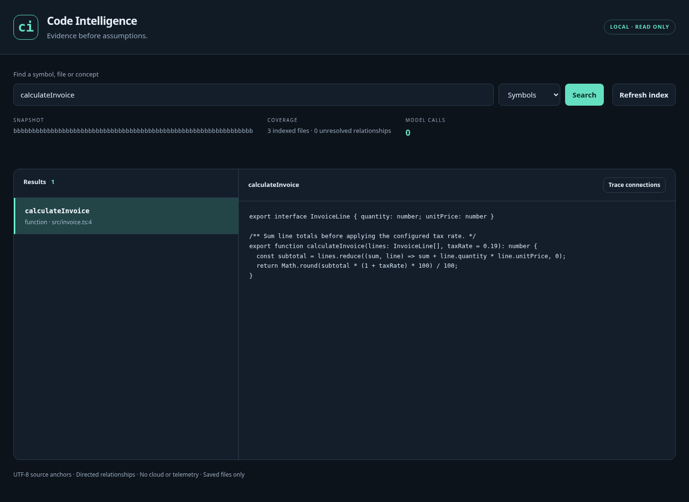

# Code Intelligence

**Local, evidence-first code intelligence for coding agents.**

[Deutsch](README.de.md) · [Rust core](native/README.md) · [Rust workflows](native/docs/workflows.md) · [Quick start](docs/QUICKSTART.md) · [Status](docs/STATUS.md)

Independent Rust 0.5 implementation combining immutable source snapshots, configured compiler navigation, directed graphs, source-bound retrieval, controlled changes, test selection and execution. Rust also owns model-provider accounting, a persistent Python debugger, signed TLS source exchange, history retirement and Docker verification. The default works without Graft, Serena, Graphify, Node, Python, a model or an API key. Optional compiler, runtime and model operations use explicitly selected host tools. The [replacement matrix](docs/RUST_REPLACEMENT.md) records behavioral evidence and limits.

## Native Rust start

```sh
cargo build --workspace --release --locked -j 2
./target/release/yoke --root /absolute/project index
./target/release/yoke --root /absolute/project context invoice
./target/release/yoke --root /absolute/project export --format html
./target/release/yoke --root /absolute/project explorer
./target/release/yoke --root /absolute/project serve
```

Use `target/release/yoke.exe` on Windows. Rust 1.94.1 or newer is required to build. The executable links programming-language grammars, SQLite FTS5, graph algorithms including real Leiden, an independent LSP client and guarded changes with durable recovery. The HTML graph inspector works offline. Explicit `export --format html-source` additionally embeds checked captured files with Code/Context/Outline tabs and exact source quotes; [source export limits](native/docs/explorer.md#explicit-captured-source-export) and source access controls apply. The separate authenticated local `explorer` command supports saved-view reload; `--allow-rebuild` grants manual capture through [the live workflow](native/docs/explorer.md#authenticated-local-live-workflow). Standard MCP tool names are shared, but advanced optional arguments and snapshot stores are distinct. [Native instructions](native/README.md) cover trusted semantic servers, context plans, verification, portable packaging and remaining limits. Actual Windows checks are recorded in [native validation](docs/validation/native-workflows.json).

[Selected graph queries](native/docs/selected-graph-queries.md) and [graph analytics](native/docs/graph-extensions.md) preserve the original source evidence. Explicit [meaning extraction](native/docs/meaning-cli.md) adds concepts, directed relationships and ordered hyperedges with quoted source support, immutable receipts and a cost ledger. Loading, querying and inspecting those graphs never starts a provider. [Refactoring intent checks](native/docs/semantic-refactor-intents.md) and [lossless host configuration patches](native/docs/host-config.md) describe their supported inputs and boundaries.

Explicit [YAML session configuration](native/docs/session-config.md) projects
hash-selected host steering files into reviewable create-only JSON profiles.
Project registrations, runtime trust and execution rights remain host-owned.

Explicit [Google Workspace capture](native/docs/google-workspace.md) selects
hash-bound Docs/Sheets/Slides shortcuts with explicit host grants. A native HTTP
route supports private resource-key headers and private stdin token input; the
trusted gws path retains its execution/account-state boundary. Immutable exports
replay offline; XLSX inspection never evaluates formulas. Authenticated Google
live export qualification remains open.

Explicit [closed-PR discussion captures](native/docs/github-discussions.md) add
bounded host-authorized GitHub observations to offline captured-source digests.
The optional handoff preview excludes discussion and implementation bodies.
An explicit [digest service workflow](native/docs/digest-service.md) adds exact
payload approval, a durable send journal and read-only outcome recovery for the
independently owned receiver contract. The explicit
[native receiver](native/docs/digest-receiver.md) adds authenticated TCP/TLS intake
and immutable receipts. Separately authorized [received metadata queries](native/docs/digest-query.md)
preserve receipt-qualified rows and directed relationships without conferring
source authority. Separate [local declaration verification](native/docs/received-source-verification.md)
and [source-bound interpretation](native/docs/received-source-interpretation.md)
bind selected independent local captures and explicitly built native Meaning
graphs without default provider execution. Public production deployment, broader
reasoning/model quality and wider upstream service equivalence remain open.

Explicit [history acquisition](native/docs/digest-history-acquisition.md) selects,
captures and maps a bounded historical batch under the verified head's scope.
Snapshot/graph/FTS/scope/receipt publication commits atomically after replay and
output admission. Explicit [persistent local history jobs](native/docs/digest-history-jobs.md)
continue across batches and process restarts under current grants and exact
revisions. The explicit [App history driver](native/docs/app-history-integration.md)
binds worker completion to signed original plans and exact queue/native revisions.
Configured production/background deployment remains open.

Explicit [Git conflict triage](native/docs/git-conflicts.md) observes the selected
worktree's actual unmerged index. Exact stage-source pages use independent host
read permissions and captured-path scopes; source files and index stay unchanged.

Explicit [compiler-bound Git impact](native/docs/git-compiler-affected.md) separately
checks immutable TypeScript base/head programs with a host-trusted compiler.
Resolved calls/constructors/tags, override bindings and type-based possible targets retain their
original byte proofs and separate context identities; no execution is inferred.

[Captured impact areas](native/docs/git-areas.md) add saved concept/file memberships
and exact directory fallback to a replayed Git report. Original quotes and
parallel observations remain intact; tied labels stay visibly ambiguous.

[Captured directory moves](native/docs/directory-moves.md) retain complete text
trees, empty directories and physical identities through configured folder
repair, reviewed plans, copied verification and conditional recovery.

[Captured file usage checks](native/docs/file-usage.md) add bounded default
deletion planning for TypeScript/JavaScript function modules with exact
provider bindings, conservative captured usages and visible unknown consumers.

Explicit reviewed [Neo4j](docs/native-neo4j-publish.md) and
[FalkorDB](docs/native-falkor-publish.md) publication preserve saved native graph
rows and evidence through separate host approval, pinned TLS/OS credentials,
immutable revisions and read-only recovery of unknown writes. Offline plans
grant no authority; live publication currently supports Windows.

Explicit [managed JSON MCP profiles](docs/native-json-hosts.md) select Cursor or
Claude configuration, with exact ownership and guarded Windows recovery.

An explicit [managed Codex MCP profile](docs/native-codex-host.md) installs one
reviewed, receipt-owned TOML entry with physical source/launch bindings and
guarded recovery. The original generic AGENTS profile keeps its identities.
Actual Codex0.163 MCP-client reads have owned Windows evidence.

Explicit [saved-plan feedback](native/docs/outcome-feedback.md#authored-outcomes-for-saved-change-plans)
records source-bound authored historical outcomes and exposes transparent
ranking. Planned result bytes and labels grant no application or execution authority.

Separate [Meaning claim outcomes](native/docs/meaning-outcome-feedback.md) retain
packet-qualified concepts, directed relations and hyperedges, original receipts
and exact source evidence. Authored labels and historical scores establish no
semantic truth, independent corroboration or observed execution.

Explicit [semantic transcript candidates](native/docs/semantic-transcript-candidates.md)
make one host-authorized model attempt over selected original imported UTF-8
bytes. Durable source/response/accounting replay supports provider-free review;
candidates create no outcome events and remain unverified interpretations.

Explicit [semantic identity](native/docs/meaning-identity.md) compares checked
native Meaning claims and asks a separately authorized host model to adjudicate
candidates. Positive cliques produce a lossless quotient with provider-free
queries; original claims, directed observations, role slots and receipts remain.

An explicit native [Python empty-suite deletion policy](native/docs/semantic-refactor-intents.md#explicit-native-python-empty-body-deletion)
can prepare a checked `pass` replacement while preserving the strict default
and ordinary approval, verification and source-recovery gates.

Explicit native [TS/JS sibling preservation](native/docs/symbol-deletion.md)
can delete one checked function-valued declarator and its AST comma while
keeping unrelated declarations and the strict default intact.

Checked [class-method decorator ownership](native/docs/symbol-deletion.md)
extends native and provider-finalized deletion while preserving neighboring
decorators, immutable anchors and independent application gates.

Explicit native [wrapped-call propagation](native/docs/propagated-delete.md)
can remove standalone parenthesized, `await` and `void` calls while checking
surviving syntax, original source proofs and guarded application.

Native [session refactoring](native/docs/agent-sessions.md#native-semantic-planning)
prepares existing semantic plans through the session CLI and MCP interface, with
mode, project and current-session checks and separate application authority.

Explicit [function binding propagation](native/docs/propagated-delete.md#explicit-function-binding-policy)
adds single const/let/var arrow and anonymous-function bindings while retaining
original entity/evidence ranges, mandatory provider proofs and guarded plans.

## TypeScript advanced runtime

Requires **Node.js 22.16+**. Python/Go and additional optional providers are installed separately. Node SQLite is experimental on the tested Node version. No model or API key is required by native indexing.

```sh
npm ci
npm run build
node dist/cli.js index --root /absolute/project --timeout 120000
node dist/cli.js find invoice --root /absolute/project
node dist/cli.js view --root /absolute/project --timeout 120000
```

The separately supplied runtime ZIP includes compiled code and the pinned TypeScript runtime dependency; start it directly with `node dist/cli.js --help`. Source ZIP includes Git history but excludes installed dependencies. No public repository or registry publication was performed in this update.

## Delivered in 0.3.0

| Capability | Implementation |
|---|---|
| Source truth | Strict snapshots, exact UTF-8 anchors, readonly captured dependencies, editor overlays, signed remote snapshots, explicit coverage limits |
| Configured semantics | TS/JS compiler contexts and rename, memory-only solution builds, actual optional Jedi/Go semantics, framed LSP and Serena capability gateway |
| Retrieval | FTS, literal search, directed traversal, bounded context plans, source-bound memory, local lexical vectors and optional model-generated vectors/reranking |
| Relationships | Additional Prisma/SQL/OpenAPI/GraphQL/Protobuf hints, candidate contract links, bounded intraprocedural dataflow, explicit Louvain/Leiden adapters |
| Changes and tests | Prepared immutable patches, isolated apply, approved original-tree writes, recovery journals, diagnostics, per-test-selection V8 coverage and optional Docker verification |
| Integration | Eight MCP tools, CLI/library, local explorer, authenticated editor service/VSIX and host-scoped source federation |
| Operation | Metadata-assisted capture, dependency-scoped semantic caches, periodic watch reconciliation, opt-in retention/pins, model-attempt cost ledger |



The historical screenshot uses labeled frontend fixture responses. The native Rust offline export has separately been opened in the actual collaborative browser and exercised with real captured source, Unicode anchors, a mobile viewport and hostile embedded text.

## Agent interface

`yoke --root /project serve` exposes **ci_status, ci_find, ci_read, ci_trace, ci_context, ci_change_prepare, ci_change_apply, ci_verify**. Read exact source before edits. Responses bind a snapshot and distinguish omissions, uncertain relationships and failures. Native tools do not get implicit provider/network/key permissions. Advanced privileges remain explicit host-side CLI/library operations; see [native workflows](native/docs/workflows.md). The retained `node dist/cli.js serve --root /project` runtime has its own [API](docs/API.md) and state.

## Checks

```sh
npm run typecheck
npm test
node scripts/configured-smoke.mjs
node scripts/live-tests.mjs native       # real Jedi/Go/clangd/PDF/image/audio providers required
node scripts/live-tests.mjs communities  # real NetworkX required
node scripts/live-tests.mjs upstreams    # actual pinned Graft/Graphify/reviewed Serena required
node benchmarks/run.mjs                 # synthetic native retrieval, not agent economics
```

Optional live gates **fail** when prerequisites are absent; they do not fall back to fakes. The default suite includes deliberately labeled protocol fixtures and real native operations. The exact completed runs and unresolved gates are in [the report](docs/validation/report.json).

## Evidence boundaries

The advanced local workflows now have independently owned Rust CLI/library paths. [Native workflows](native/docs/workflows.md) documents their explicit permissions and configuration. Feature-for-feature parity with every upstream or commercial product, all-language-server certification, hosted Linux/macOS execution and whole-agent savings require separate evidence. Actual Windows compiler, debugger, Docker, credential-store and TLS tests are distinguished from labeled protocol fixtures in [STATUS.md](docs/STATUS.md). The retained TypeScript 0.3 implementation and its earlier reports remain available.

## License

Own implementation: MIT. TypeScript runtime notices retained. Optional upstream applications, model weights and media libraries have their own licenses and are **not** bundled. No GPL Serena application code, paid JetBrains plugin or hosted service is included. External commands in copied trees retain process privileges unless a separately validated host/container sandbox is used.

Explicit [mixed-source input preparation](native/docs/mixed-views.md) exports
checked frozen code, Office text/XML and permitted PDF page excerpts with their
original provenance and bounded ordered context groups. It performs no model
call; mixed semantic execution and cross-source graph relationships remain open.

[Mixed interpretation claim checks](native/docs/mixed-meaning-claims.md) retain
host-submitted directed/parallel/role-bearing observations and reread exact typed
source support. The result preserves unverified interpretation status and
original source provenance without a provider call or persisted graph.

Explicit [mixed-source meaning builds](native/docs/mixed-meaning-provider.md)
add trusted host-provider execution, durable accounting/response artifacts and
source-bound replay. Status/jobs start no provider; unknown sends retain their
reservation and never retry automatically. Interpretations remain unverified.

Explicit [immutable compiler inlining](native/docs/compiler-inline.md) adds
host-selected TypeScript 5.8.3 function-binding and finite classic function-body
inline plans for TS/TSX/JS/JSX
through native sessions and the existing facade, with exact source/effect checks
and separate verification, approval, application and recovery.
