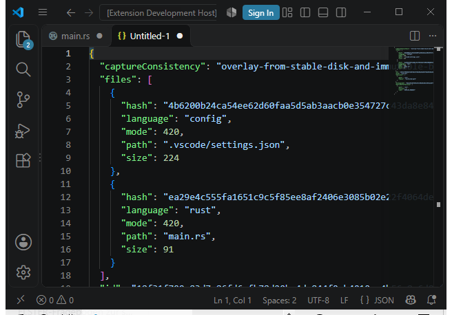
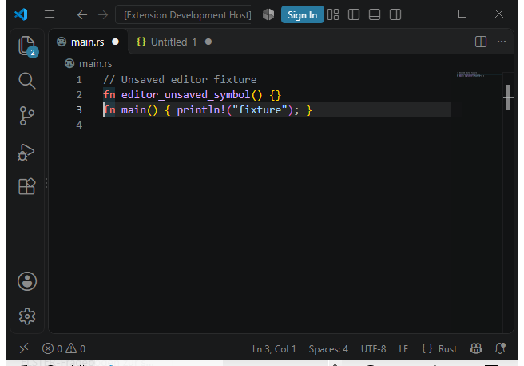

# Windows native package, bundled host and desktop inspection

Runtime source: `f8b02d4eb0145de95f108e12df51786d368b6ef3`.
Packaging source: `e89ae42cbb925a9e0cf6f36d9d451f34d0ac6f6e`.
These are separately recorded provenances. This is Windows development evidence;
`exactHeadBuild`, `currentPlatformAcceptance`, `releaseQualification` and
`wholeProjectComplete` remain false.

The [index](index.json) binds all 383 members of the [evidence ZIP](evidence.zip):
61,399,747 expanded bytes, 5,653,176 ZIP bytes, SHA-256
`ee514d95755b8fcbacbe79b7a5037319a694bf39045ca1f312c1d12506e04689`. The [summary](summary.json) retains scoped results and failures.
No native EXE/PDB/VSIX payload, private history bodies or Session capabilities are
published. The actual development archives remain local deliverables.

| Executed scope | Result |
| --- | --- |
| Paired-source and package guards | 62 passed, 0 failed, 0 skipped; natural root/Job exit |
| Source equivalence | 1,050 exact members; 1,048 common records identical; precisely two pinned packaging Python differences |
| Authored native inputs | All 1,006 entries identical; exact three-file Git delta and no authored build hook |
| Locked Cargo graphs | Full identities, features and edges match through an explicit root-package mapping |
| Native archive | 1,337 members; 316 dependencies; 557 license texts checked |
| VSIX | Native-only Windows x64, version 0.5.0, identical selected Rust executable |
| Actual bundled extension host | VS Code 1.143.1; all original host assertions pass |
| Separate visible fixture | Overlay JSON and dirty Rust source inspected; natural root/Job exit |

The native ZIP is 32,690,604 bytes, SHA-256
`839649a0e9344e1a0402e2bee8c5df7fa536f8764ad005e65abdd10de2b3fa78`.
The VSIX is 32,767,397 bytes, SHA-256
`92e5cccb8e2a1569bea686da133c88deb02a00a56407b3162c96f7af153a3c31`.
Both contain the previously admitted 142,702,080-byte CLI, SHA-256
`b81483cf4024fdca8647ec22000e9be64486b642caa0e63b7cf6b19ba02be1e5`.
These dependency counts include the resolved build graph; they are not claims
about runtime module loading or provider/backend qualification.

## Admission and lifecycle

Both fixed clean roots, complete memberships, exact exclusions, Cargo-config
absence and protected roles are checked before image admission and at final
acceptance. F8 producer/version receipts are admitted by unchanged validators;
no receipt or runtime identity is relabeled e89. The rejected e89 builds remain
unread and unadopted. Source and package pins remain held through execution.
External compiler, dependency-cache and host-tool trust remains explicit.

Both Cargo metadata observations share one 30-second deadline. The overall
pipeline remains 1,800 seconds; native packaging 900, VSIX 300, host request 180
and host outer 190 seconds, all clipped to the shared deadline. Original outer
one-second drain and sole two-second abort remain. All five accepted stages
have exit 0 and empty Jobs before forced cleanup. The host stage takes 13.516
seconds; no internal force cleanup qualifies success.

The actual host uses `-UseBundledRuntime` and the exact original JavaScript
assertions: Rust/default bundled selection, unsaved source binding, ignored
workspace executable authority, protected open-buffer exclusion and unchanged
saved source. The separately pinned PowerShell launcher removes only its
internal `taskkill` path and refuses on failure to exit naturally. It is a
derived launcher; execution of the untouched original launcher is not claimed.

## Actual visible inspection

A separate visible fixture delegates to the byte-identical original test host,
then waits at most 90 seconds for an operator acknowledgement inside the same
180/190-second request/outer limits. Its source-controlled visible launcher
changes only Code's own window style. This fixture does not alter the accepted
functional package run. The second visible run passes in 59.874 seconds with
natural root/tree exit. The editor bridge has stopped before inspection.

The available desktop is narrow. I maximized the owned window, hid its sidebars
and cleared its informational notification, then inspected the actual generated
JSON and the dirty `main.rs` containing `editor_unsaved_symbol`. No source was
saved. These are two desktop views, not mobile/dashboard or broad accessibility
acceptance.

The local ready/acknowledgement channels and raw UI trees are excluded. The two
wrapper copies replace only their fixed path/one-time test nonce declaration
with placeholders and are explicitly named `redacted`. They are not byte-exact
replay sources. The complete unredacted wrappers, specification and operator-channel records
remain local; published controller and launcher sources retain their indexed hashes. Review can verify public receipts and image hashes; it
cannot independently reconstruct the omitted operator-channel data.

## Retained failures and scope limits

- The first 62-test run has 61 passes and one fixture setup error: its isolated
  environment omitted USERPROFILE, needed by the original guard's eager home
  lookup. The owned fixture was corrected and all 62 tests rerun.
- The first package run stops before Code because PowerShell 7 is unavailable.
  Its whole receipt remains incomplete; no partial package is adopted.
- The first visible fixture exceeds its unchanged 90-second acknowledgement
  bound and fails. Its natural exit is retained, not counted as acceptance.
- Windows PowerShell 5 refuses the optional UI-helper script under its existing
  policy. No policy is changed and no IEX/alternate-script interpreter is used;
  documented individual Orca UI operations perform the inspection instead.

Official portable Code 1.143.1 and PowerShell 7.6.6 archives are retained locally
with checked publisher download hashes. PowerShell is selected only in the
owned child environment, with telemetry opt-out there. No global installation,
PATH, registry or execution-policy change occurs. Vendor tools remain trusted
inputs rather than independent binary attestations.

The earlier [CLI/original-history scope](../release-cli-original-history/README.md)
and its failures remain separate. Counts are nonadditive. Current exact-head
build/platform gates, strict macOS memory capability/history timing, live owner
retirement/purge, broader recovery/accessibility, all 353 full-contract flags,
77 runtime/backend qualifications, Google live export, production App setup,
main integration and HECer/Code-Intelligence publication remain open.
