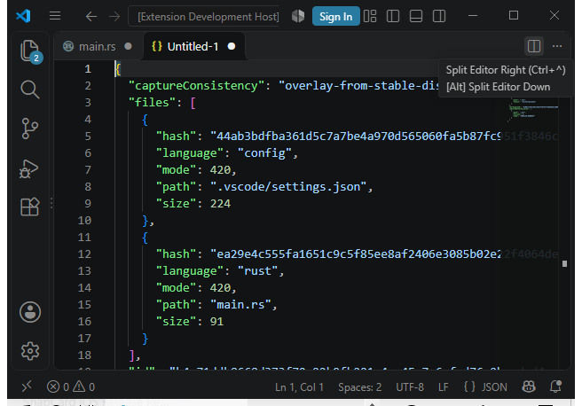
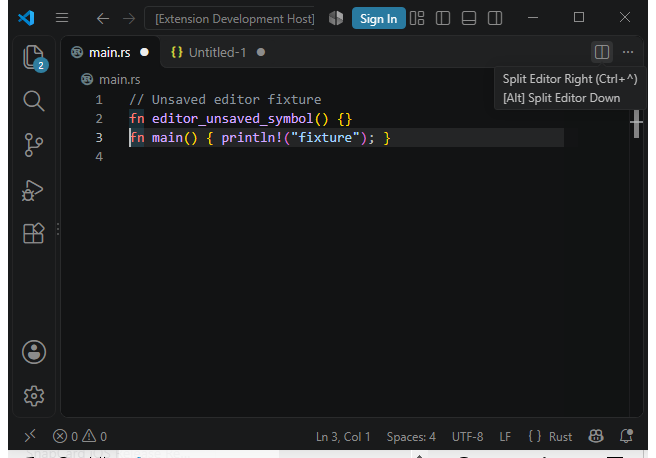

# Runtime shutdown and matching Windows development package

This checkpoint binds native source `704b647d625dcc5f359386b20834d329ffb6cdf4`
(tree `00cc7bba60ce8464b39c33f527a9262831da85ac`) and Code Intelligence 0.5.0
for `win32-x64`. It qualifies the listed local checks. Full platform/contracts,
main integration and release publication remain open.

The Session rechecks its original lifetime after terminal cleanup, and typed
Close requires an exact `closed` response. A finite paused CLI batch confirms
shutdown before publishing its requested observations. Cleanup refusal retains
precedence. Empty batches, late terminal responses and unsuccessful shutdown
must not publish successful output. The production stop/Drop budgets are unchanged.

| Check | Actual result |
| --- | --- |
| Whole library harness | 773 passed, 0 failed, 7 original ignores, 0 filtered |
| Whole CLI unit harness | 16 passed, 0 failed, 0 ignored, 0 filtered |
| Typecheck / npm | Exit 0; 260 passed, 0 failed, 3 original skips |
| Workspace/all-target Clippy | `-D warnings`, exit 0; 757 Cargo artifact observations are metadata |
| History admission guards | 41 passed at source 704 |
| Runtime response guards | 25 passed at source 704 |
| Package guards | 53 passed at source 704 |
| Visual admission guards | 21 passed at source 704, including an inert Node VM clock regression |
| Earlier unchanged unit-controller guards | 72 passed at source 809bac07; retained as earlier controller evidence |
| Fresh matching release/version | Natural completion in 1138.484 seconds; `yoke 0.5.0` |
| Actual original-history consumers | Native, Serena and persistent Python each read 42 records, in packages of 28+14 |
| Actual runtime CLI cases | Six expected outcomes; two intentional Close failures preserve raw exit 1 and zero published events |
| Native archive / native-only VSIX | 1,339 / 1,344 members; same admitted native image |
| Actual bundled editor host | Original assertions pass under Code 1.143.1 |
| Separate actual desktop inspection | Overlay JSON and dirty Rust source viewed; parent-observed acknowledgement validation at 58.759 seconds within the original 90-second window |

The whole unit harnesses use `--test-threads=1`; original ignored tests remain
ignored. Those suites and guard counts do not certify every authored integration
test or an entire requirement area. The six CLI outcomes use a fresh admitted
release, not the unit images. Both owning history Sessions exit before cleanup;
the selected persistent-Python runtime additionally exits before cleanup.

The fresh release producer is `release-cli-compiler-lld-704-r2`; its matching
version run is `release-cli-compiler-lld-version-704-r1`. Release settings retain
thin LTO, one codegen unit and symbol stripping. Fixed final-bin bundled LLD is
the reviewed compiler policy. The original 3600-second build, 60-second inner
quiescence, one-second natural drain and sole two-second abort limits remain.
Installed tool images, external dependencies and caches remain trusted; metadata
pins are not tool-byte attestation or an equal-privilege host sandbox.

Package run `native-vsix-lld-704-r2` uses the existing explicit
`fetchMissingLicenses:true` option. Its native ZIP has 316 dependencies and 557
license texts. Native image SHA-256:
`e77a37583af956b82214b957b20f4563cf40a71939bcbbc614270307c0eafeba`.
Native archive SHA-256:
`85763b30c6873c058c264d9925982bc9736fd8189d06536c28998ee5d1878566`.
VSIX SHA-256:
`1fbd084041d76a053ebe96a7a9ee2c9f5f102c33ca92a264c7adb9713c0c44e4`.

The separate visual run `native-vsix-visual-lld-704-r2` re-admits the complete
matching package, producer and version proofs. The wrapper preserves original
host assertions, starts the readiness clock before publication, and rejects
late acknowledgements. The parent actually viewed both PNGs below before
writing the private current-run acknowledgement. Natural root exit and empty
owned Jobs precede forced cleanup; final source, control, archive, extraction,
tool-metadata and image pins still agree. No optional policy-refused GUI helper
or interpreter/policy bypass was used.

Retained failures remain failures. The cold CLI producer
`unit-cli-build-704-r2` exits Cargo successfully but fails the original natural
helper-quiescence gate before image admission. The first matching package run
refuses a missing base64-simd license. The first visual run expires its original
90-second acknowledgement window; it ends with raw exit 1 and natural empty
Jobs. A later acknowledgement does not repair that failed receipt. Earlier
pre-output admission refusals produced no qualified image. Nothing here adopts
an old rejected output, proves the exclusive cause of MSVC helper behavior or
relaxes the runtime, memory, resource or cleanup contract.

`summary.json` is the compact result; `index.json` maps every archive member to
its original local text receipt, byte count and hash. `evidence.zip` contains
763 text/source/metadata members, 97,138,471 expanded bytes, and 7,873,045 ZIP
bytes. ZIP SHA-256:
`5c893d025facfca572537acb1125bc257dfbf724293e9e1eaa634d8daa10fbe9`.
Raw copied receipts preserve their original source IDs and false scope flags.
Private protocol/configuration bodies, original history frames, operator
spec/ready/ack/observed contents, native EXE/PDB payloads and ZIP/VSIX payloads
are excluded. Private channel hashes in the visual proof are retained.

The private producer `worker-spec.json` is intentionally excluded: 26 of its
27 fixed producer proof files and all 22 version proof files are public here.
Local admission held and checked all 27+22. This export is not a complete
offline replay of the private producer context. `retained-causes.json` adds
bounded parent-observed error excerpts with source paths, byte offsets and
excerpt hashes for the license and visual-expiry causes. Their full local
cause logs remain private; the original failed root/job receipts stay unchanged.
The exact acknowledgement interval is parent-observed from that private channel;
the public host receipt independently records 63.120 seconds and natural exit.
Long overlay hashes clip at the narrow test viewport; original host assertions
check their exact bytes independently of the screenshots.

Current full same-source hosted shards/doctests, all integration targets,
selected language-server acceptance, live maintenance/older-binary/mobile
qualification and external provider campaigns remain separate. The strict
macOS 256 MiB address-space capability remains unavailable; this Windows
checkpoint does not replace it with a different metric or raise its ceiling.
The original contract inventory, external prerequisites, main and final public
release remain open. No full-project or release certification is claimed.
